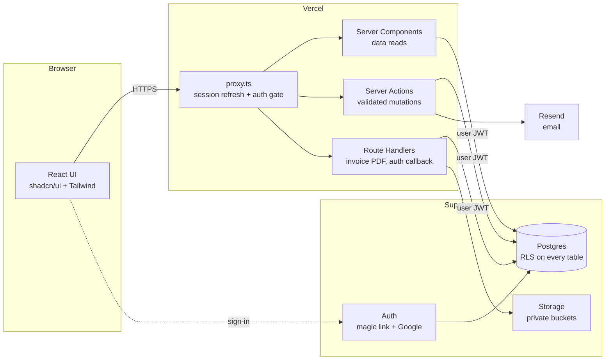

# Architecture

## Goals and constraints

| Requirement from Studio North | What it means for the design |
| --- | --- |
| **Lightweight & easy to use** | One app and one database. No microservices, no separate API server. Few dependencies. Opinionated UI kit (shadcn/ui). |
| **Accessible from anywhere** | Responsive web app on Vercel's global edge network. Works on desktop, tablet and phone, with nothing to install. |
| **Secure** | Invite-only auth. Postgres Row Level Security (RLS) on every table, so the database itself enforces permissions. Secrets stay server-side. See [SECURITY.md](SECURITY.md). |
| **Scales with the agency** | Managed Postgres, stateless app tier, and a schema that can grow (e.g. Stripe or a client portal later) without rewrites. |

## System overview



### Core principle: the user's own session does the work

Every read and write runs **as the signed-in user**, using their JWT with the Supabase server client. Postgres RLS then decides what they can see or change. Hiding things in the UI is a convenience, not the security boundary.

The Supabase **secret key** (which bypasses RLS) is used only in a small set of admin-only server modules (inviting users, changing auth metadata). Every one of those code paths checks the caller is an Admin first.

## Request flow

1. **`proxy.ts`** (Next.js's request interceptor, formerly `middleware.ts`) refreshes the Supabase auth cookie and redirects unauthenticated requests to `/login`. It does no authorisation beyond "is signed in".
2. **Layouts / pages (Server Components)** call `requireUser()` / `requireRole('admin')` from `lib/auth`, which validate the JWT server-side (`supabase.auth.getClaims()`, never the unverified cookie session). Then they query Supabase directly.
3. **Mutations** go through **Server Actions** in `features/<domain>/actions.ts`:
   - parse input with the domain's Zod schema
   - check role (for a good error message; RLS is the real gate)
   - call Supabase (insert/update, or an RPC for multi-step operations)
   - `revalidatePath` / `revalidateTag` the affected views
4. **Route Handlers** serve things that aren't pages: `/auth/callback`, `/api/invoices/[id]/pdf`.

### Where business logic lives

| Kind of logic | Lives in | Why |
| --- | --- | --- |
| Who can see/change a row | Postgres RLS policies | Can't be bypassed by a buggy page or a direct API call |
| Money arithmetic (invoice totals, tax) | Postgres triggers / generated columns | One source of truth, exact `numeric` maths, no JS float errors |
| Multi-step state changes (issue invoice, mark paid, void) | Postgres functions (RPC) | Atomic, run in one transaction, enforce valid state transitions |
| Reporting (dashboard KPIs, project burn) | Postgres views / functions | Fast aggregate queries close to the data |
| Input validation, UX rules | Zod schemas + Server Actions | Friendly errors, shared with the client-side form |
| Presentation | React components | — |

## Feature modules

| Module | Main screens | Notes |
| --- | --- | --- |
| **Dashboard** | `/dashboard` | Admin sees the full business-health view. Managers/Members see a personal "my tasks + my hours" view. |
| **Clients** | `/clients`, `/clients/[id]` | Contacts, projects, invoices and balance per client |
| **Projects** | `/projects`, `/projects/[id]` | Status, dates, budget, burn (labour + expenses vs budget), tasks, time |
| **Tasks** | `/tasks` | Board and list views, filter by team, assignee or project |
| **Teams** | `/teams`, `/teams/[id]` | Membership, team leads, team task load |
| **Time** | `/time` | Weekly timesheet grid for the current user. Managers can view everyone's. |
| **Invoices** | `/invoices`, `/invoices/new`, `/invoices/[id]` | Draft, then issue (numbered, locked), then send PDF, then mark paid / void |
| **Expenses** | `/expenses` | Categorised, optionally tagged to a project, receipt upload |
| **Settings** | `/settings/*` | Company details, tax default, invoice prefix, users and roles, staff cost rates, expense categories |

## Folder structure (planned)

```
.
├── src/
│   ├── app/
│   │   ├── (auth)/                 # login, auth/callback, auth/confirm (no app chrome)
│   │   ├── (app)/                  # authenticated shell: sidebar, top bar
│   │   │   ├── dashboard/
│   │   │   ├── clients/
│   │   │   ├── projects/
│   │   │   ├── tasks/
│   │   │   ├── teams/
│   │   │   ├── time/
│   │   │   ├── invoices/
│   │   │   ├── expenses/
│   │   │   └── settings/
│   │   └── api/invoices/[id]/pdf/route.ts
│   ├── features/                   # one folder per domain
│   │   └── invoices/
│   │       ├── queries.ts          # server-only reads
│   │       ├── actions.ts          # 'use server' mutations
│   │       ├── schemas.ts          # Zod schemas (shared with forms)
│   │       ├── pdf/                # @react-pdf/renderer template
│   │       └── components/
│   ├── components/
│   │   ├── ui/                     # shadcn/ui primitives
│   │   └── layout/                 # shell, nav, page headers
│   ├── lib/
│   │   ├── supabase/
│   │   │   ├── server.ts           # cookie-based client for RSC / actions
│   │   │   ├── client.ts           # browser client (auth UI only)
│   │   │   └── admin.ts            # secret-key client, `server-only`, admin paths only
│   │   ├── auth.ts                 # requireUser, requireRole
│   │   ├── money.ts                # formatting helpers (display only)
│   │   └── database.types.ts       # generated by `supabase gen types`
│   └── proxy.ts
├── supabase/
│   ├── config.toml
│   ├── migrations/                 # timestamped SQL, source of truth for schema
│   ├── tests/                      # pgTAP tests (RLS + functions)
│   └── seed.sql                    # local/dev demo data only
├── tests/e2e/                      # Playwright
└── docs/
```

## Key technical decisions

| # | Decision | Rationale | Alternatives considered |
| --- | --- | --- | --- |
| 1 | **Supabase client + RLS, no ORM** | RLS needs queries to run as the user. ORMs like Prisma/Drizzle normally connect as a privileged role and bypass RLS. Generated TS types give type safety anyway. | Drizzle with RLS-aware connections (more moving parts) |
| 2 | **Server Components for reads, Server Actions for writes** | Minimal client JS, no hand-written API layer, built-in CSRF protection on actions | REST/tRPC API layer (unnecessary for a single web client) |
| 3 | **Money as Postgres `numeric(12,2)`, totals computed in DB** | Exact decimal arithmetic. Totals can't drift from line items. | Integer cents in JS (still need DB-side enforcement) |
| 4 | **Sensitive columns live in sibling tables** | RLS is row-level, so a budget column on `projects` would be visible to anyone who can see the project. Putting it in `project_budgets` with its own policy fixes that cleanly. | Column-level grants + views (harder to reason about) |
| 5 | **Role stored in `profiles`, read by `SECURITY DEFINER` helpers** | Role changes and deactivation apply instantly, with no stale JWT claim | Custom access-token hook claim (faster, but stale until token refresh) — revisit if performance requires |
| 6 | **Invoices numbered on issue, immutable afterwards** | Matches accounting practice: no gaps in issued numbers, and corrections happen by voiding and reissuing | Editable invoices (audit risk) |
| 7 | **PDFs rendered on demand + archived to Storage on issue** | The archived PDF is exactly what the client received. On-demand rendering gives previews of drafts. | Headless Chrome (heavy on serverless) |
| 8 | **Labour cost uses effective-dated cost rates** | Pay rises don't rewrite historical project margins | Single current rate (historical figures drift) |
| 9 | **Single currency, one tax rate per invoice** | Matches Studio North today and keeps reporting simple | Multi-currency (deferred) |

## Environments and deployment

| Environment | App | Database | Purpose |
| --- | --- | --- | --- |
| **Local** | `pnpm dev` | `supabase start` (Docker) | Development, with `seed.sql` demo data |
| **Preview** | Vercel preview deployment per PR | Supabase **staging** project | Review features, run E2E tests |
| **Production** | Vercel production (`main`) | Supabase **production** project | Live, real data. Never seeded. |

- **Schema changes** are SQL migrations in `supabase/migrations/`, committed with the feature. CI applies them to staging on PR merge and to production on release (`supabase db push`), never by hand in the dashboard.
- **Types**: `supabase gen types typescript` regenerates `database.types.ts` after every migration. CI fails if it's stale.
- **CI (GitHub Actions)**: lint → typecheck → unit tests → pgTAP (against a local Supabase in CI) → build. Playwright runs against the Vercel preview.
- **Env vars** live in Vercel project settings (per environment) and `.env.local` for development. See `.env.example`.

## Out of scope for v1 (designed not to block)

- Client portal (clients logging in): RLS helpers and `clients` table leave room for it
- Online payments (Stripe): `invoices.status` and `payments` can be extended
- Multi-currency
- Accounting-software sync (Xero/QuickBooks): export to CSV covers the gap for now
- Native mobile apps: the responsive web app covers mobile use
