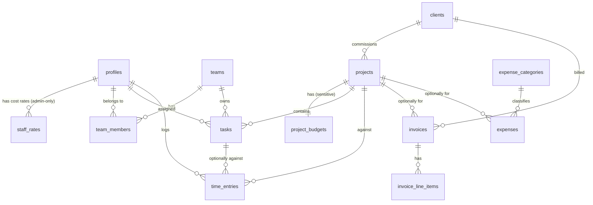

# Data model

All tables live in the `public` schema, have RLS **enabled**, and use `uuid` primary keys (`gen_random_uuid()`). They also get `created_at` / `updated_at` timestamps (`updated_at` maintained by trigger). Money is `numeric(12,2)` in the company's single base currency.

## Entity relationships

## Tables

### People and access

**`profiles`**: one row per staff user, created by trigger when an `auth.users` row is created.

| Column | Type | Notes |
| --- | --- | --- |
| `id` | uuid PK | = `auth.users.id` |
| `full_name` | text | |
| `email` | text | Copied from auth for display |
| `role` | `app_role` enum | `admin` \| `manager` \| `member`. Default `member`. |
| `is_active` | boolean | `false` = deactivated: helpers return no role, so RLS denies everything |
| `weekly_capacity_hours` | numeric(4,1) | Default 37.5. Used for utilisation. |
| `avatar_path` | text null | Storage path |

**`staff_rates`**: internal hourly cost per person, effective-dated. **Admin-only.**

| Column | Type | Notes |
| --- | --- | --- |
| `profile_id` | uuid FK → profiles | |
| `cost_rate` | numeric(10,2) | Per hour |
| `effective_from` | date | Unique per (`profile_id`, `effective_from`) |

**`teams`**: `id`, `name` (unique), `description`, `archived_at`.

**`team_members`**: `team_id`, `profile_id` (composite PK), `is_lead` boolean. Many-to-many.

### Clients and projects

**`clients`**

| Column | Type | Notes |
| --- | --- | --- |
| `name` | text | Company name |
| `contact_name`, `contact_email`, `contact_phone` | text | Primary contact |
| `billing_address` | text | Printed on invoices |
| `notes` | text | |
| `archived_at` | timestamptz null | Soft-archive. Clients with invoices are never hard-deleted. |

**`projects`**: visible to everyone (so members can log time and see tasks).

| Column | Type | Notes |
| --- | --- | --- |
| `client_id` | uuid FK → clients | |
| `name`, `code` | text | `code` is a short reference, e.g. `NRTH-014` |
| `status` | `project_status` enum | `lead` \| `active` \| `on_hold` \| `completed` \| `cancelled` |
| `start_date`, `end_date` | date null | Used for "time elapsed" in burn calculations |
| `owner_id` | uuid FK → profiles | Project manager |

**`project_budgets`**: financial fields split out from `projects` (see [Architecture decision 4](ARCHITECTURE.md#key-technical-decisions)).

| Column | Type | Notes |
| --- | --- | --- |
| `project_id` | uuid PK/FK → projects | 1:1 |
| `budget_amount` | numeric(12,2) | Total project budget (cost ceiling) |
| `fee_amount` | numeric(12,2) null | Agreed fee to the client, if different from budget |

### Work

**`tasks`**

| Column | Type | Notes |
| --- | --- | --- |
| `project_id` | uuid FK null | Null = internal/non-project task |
| `team_id` | uuid FK → teams | Owning team (required) |
| `assignee_id` | uuid FK → profiles null | Optional individual within the team |
| `title`, `description` | text | |
| `status` | `task_status` enum | `todo` \| `in_progress` \| `review` \| `done` |
| `priority` | `task_priority` enum | `low` \| `normal` \| `high` \| `urgent` |
| `due_date` | date null | |
| `estimate_hours` | numeric(6,2) null | |
| `position` | integer | Ordering on the board |
| `created_by` | uuid FK → profiles | |

**`time_entries`**

| Column | Type | Notes |
| --- | --- | --- |
| `profile_id` | uuid FK → profiles | Who did the work. Defaults to `auth.uid()`. |
| `project_id` | uuid FK → projects | Required |
| `task_id` | uuid FK → tasks null | Optional |
| `entry_date` | date | |
| `hours` | numeric(5,2) | `> 0 and <= 24` |
| `notes` | text | |
| `billable` | boolean | Default `true` |

Labour cost is **not stored** here. It's computed in admin-only functions by joining `staff_rates` on the rate effective at `entry_date`, so members' rows never expose a cost.

### Money

**`invoices`**

| Column | Type | Notes |
| --- | --- | --- |
| `number` | text unique null | Assigned on issue: `{prefix}-{YYYY}-{seq}`, e.g. `SN-2026-0042`. Null while draft. |
| `client_id` | uuid FK → clients | |
| `project_id` | uuid FK null | |
| `status` | `invoice_status` enum | `draft` → `issued` → `paid`, or `void` |
| `issue_date`, `due_date` | date | `due_date` defaults to issue + payment terms |
| `tax_rate` | numeric(5,2) | Percent. Defaults from settings. |
| `subtotal`, `tax_amount`, `total` | numeric(12,2) | **Maintained by trigger** from line items. Never written by the app. |
| `paid_at` | date null | Set by `mark_invoice_paid()` |
| `sent_at` | timestamptz null | Last time it was emailed |
| `pdf_path` | text null | Archived PDF in the `invoices` Storage bucket, written on issue |
| `notes` | text | Printed footer / payment instructions |

"Overdue" is **derived**, not stored: `status = 'issued' and due_date < current_date`.

**`invoice_line_items`**: `invoice_id`, `position`, `description`, `quantity numeric(10,2)`, `unit_price numeric(12,2)`, `amount` (generated: `quantity * unit_price`). Editable only while the parent invoice is `draft` (enforced by trigger).

**`expense_categories`**: `id`, `name` (unique), `archived_at`. Seeded with e.g. Software, Contractors, Equipment, Travel, Office, Marketing.

**`expenses`**

| Column | Type | Notes |
| --- | --- | --- |
| `expense_date` | date | |
| `amount` | numeric(12,2) | Tax-inclusive, as paid |
| `category_id` | uuid FK | |
| `vendor`, `description` | text | |
| `project_id` | uuid FK null | Counts toward project burn when set |
| `receipt_path` | text null | `receipts` Storage bucket |
| `created_by` | uuid FK → profiles | |

### System

**`company_settings`**: single row (enforced by `id boolean primary key default true check (id)`): company name, address, logo path, `currency_code` (e.g. `GBP`), `default_tax_rate`, `payment_terms_days`, `invoice_prefix`, bank/payment details for invoice footers.

**`invoice_sequences`**: `year`, `last_value`. Incremented inside `issue_invoice()` with a row lock, so numbers are gap-free per year.

**`audit_log`**: `table_name`, `record_id`, `action` (`insert`/`update`/`delete`), `actor_id`, `changed` jsonb (old → new), `at`. Written by triggers on `invoices`, `invoice_line_items`, `expenses`, `staff_rates`, `project_budgets`, `profiles.role`. Admin read-only; nobody can update or delete it.

## Database functions (RPC)

| Function | Who | What |
| --- | --- | --- |
| `current_role()` | internal | `SECURITY DEFINER`. Returns the caller's `app_role`, or null if inactive/missing. |
| `is_admin()`, `is_manager_or_admin()` | internal | Thin wrappers used in policies |
| `issue_invoice(invoice_id)` | admin | Validates the draft has lines, assigns number, sets `issued`, locks lines |
| `mark_invoice_paid(invoice_id, paid_on)` | admin | `issued` → `paid` |
| `void_invoice(invoice_id, reason)` | admin | `issued` → `void`. The number is kept (never reused). |
| `project_financials(project_id?)` | admin, manager | Budget, labour cost, expenses, invoiced, collected, burn %, elapsed % |
| `dashboard_summary(from, to)` | admin | KPI block for the dashboard (below) |
| `team_utilisation(from, to)` | admin, manager | Hours logged vs capacity per person and team. Hours only, no cost. |

Functions that need data the caller couldn't read directly are `SECURITY DEFINER` with `set search_path = ''`, and they **check the caller's role first**. Each one gets a pgTAP test proving that a member calling it gets an error.

## Derived metrics

| Metric | Definition |
| --- | --- |
| **Revenue (collected)** | Sum of `invoices.total` where `status = 'paid'`, by `paid_at` |
| **Invoiced** | Sum of `invoices.total` where `status in ('issued','paid')`, by `issue_date` |
| **Outstanding AR** | Sum of `total` where `status = 'issued'` |
| **Overdue AR** | Outstanding where `due_date < today`, bucketed 1–30 / 31–60 / 60+ days |
| **Expenses** | Sum of `expenses.amount` by `expense_date` |
| **Net profit (cash)** | Collected revenue − expenses (labour shown separately: salaries are paid outside this tool) |
| **Project labour cost** | Σ `hours × cost_rate` (rate effective on `entry_date`) |
| **Project burn %** | (labour cost + project expenses) ÷ `budget_amount` |
| **Project at risk** | Burn % > 90%, **or** burn % exceeds time-elapsed % by more than 15 points |
| **Project margin** | (`fee_amount` or invoiced) − (labour cost + project expenses) |
| **Utilisation** | Hours logged ÷ `weekly_capacity_hours` (also billable-only version) |

### Admin dashboard contents

- KPI tiles: collected revenue (MTD / YTD), expenses (MTD / YTD), net profit, outstanding AR, overdue AR
- 12-month revenue vs expenses chart
- AR ageing (who owes what, how late)
- Projects at risk: burn vs elapsed
- Team utilisation (last 4 weeks)
- Upcoming and overdue tasks

## Access matrix

`R` = read, `W` = create/update, `D` = delete, `—` = no access. "Own" = rows where `profile_id`/`assignee_id` is the caller. "Team" = tasks whose `team_id` is one of the caller's teams.

| Table | Admin | Manager | Member |
| --- | --- | --- | --- |
| `profiles` | RWD | R | R (names/avatars); W own name/avatar |
| `staff_rates` | RWD | — | — |
| `teams`, `team_members` | RWD | RW | R |
| `clients` | RWD | RW | R‡ |
| `projects` | RWD | RW | R |
| `project_budgets` | RWD | RW | — |
| `tasks` | RWD | RWD | R team + own; W status of own/team tasks only* |
| `time_entries` | RWD | R all; W own | RWD own |
| `invoices`, `invoice_line_items` | RWD† | — | — |
| `expenses`, `expense_categories` | RWD | — | — |
| `company_settings` | RW | R (name/logo) | R (name/logo) |
| `audit_log` | R | — | — |
| Storage `invoices`, `receipts` | RW | — | — |

\* A `BEFORE UPDATE` trigger on `tasks` rejects changes to anything other than `status` and `position` when the caller is a member, because RLS can't restrict individual columns.
† Issued invoices can only change through the RPCs above. Drafts can be deleted, issued ones can't.
‡ Members need client names to understand their projects. If contact details should be hidden from them, move them into a `client_contacts` sibling table (same pattern as `project_budgets`).

> **For review:** should Managers be able to create and send invoices? Should Members see client names? These are open questions for the roadmap discussion.
